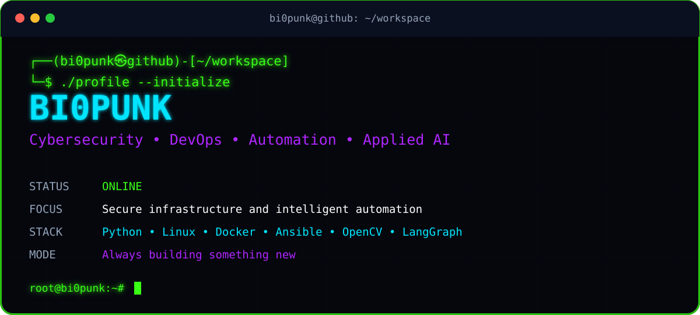
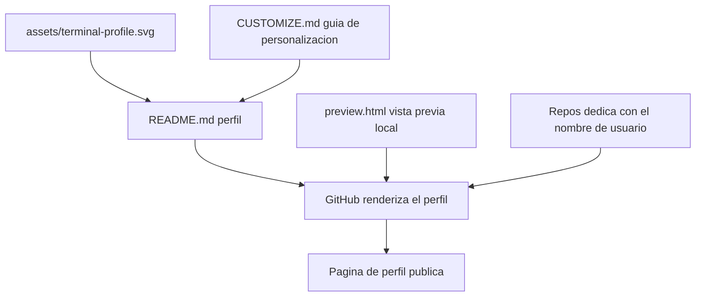

<div align="center">



<br>


</div>

---

## `root@bi0punk:~# ./stack --full`

<table>
<tr>
<td width="50%" valign="top">

### Core


### Backend


### AI and Data


</td>
<td width="50%" valign="top">

### Infrastructure


### Observability


### Security


</td>
</tr>
</table>

---

## `root@bi0punk:~# system-status`

```diff
+ Infrastructure automation       ONLINE
+ Threat detection                ONLINE
+ Security monitoring             ONLINE
+ Local artificial intelligence   ONLINE
+ Data processing pipelines       ONLINE
+ Computer vision systems         ONLINE
+ Continuous learning             ALWAYS ON
```

---

## Contenido

- [Características](#características)
- [Arquitectura](#arquitectura)
- [Stack](#stack)
- [Estructura del repositorio](#estructura-del-repositorio)
- [Uso](#uso)
- [Configuración](#configuración)
- [Roadmap](#roadmap)
- [Licencia](#licencia)

## Características

- README de perfil de GitHub con estética de terminal cyberpunk.
- Banner principal vectorial (`assets/terminal-profile.svg`).
- Badges por categorías de stack: Core, Backend, AI and Data, Infrastructure, Observability y Security.
- Bloque de estado estilo `system-status` con `online`.
- Vista previa HTML local (`preview.html`) para revisar el perfil sin publicarlo.
- Guía de personalización en `CUSTOMIZE.md`: cambiar usuario, paleta de colores y despliegue.

## Arquitectura



El repositorio funciona como página de perfil: GitHub muestra `README.md` como landing del perfil; el banner SVG da la identidad visual; `preview.html` sirve para previsualización local y `CUSTOMIZE.md` documenta cómo adaptarlo.

## Stack

Stack declarado en el perfil (badges):

| Categoría | Tecnologías |
|---|---|
| Core | Python, Bash, SQL, JavaScript |
| Backend | FastAPI, Flask, Django, REST API |
| AI and Data | OpenCV, YOLO, Pandas, LangChain, Local LLM |
| Infrastructure | Docker, Ansible, GitLab CI, Nginx, Tailscale |
| Observability | Grafana, Prometheus, Loki, Datadog |
| Security | Kali Linux, SIEM, Threat Intel, Hardening |

## Estructura del repositorio

```
bi0punk/
├── README.md              # Perfil (lo muestra GitHub)
├── CUSTOMIZE.md           # Guía de personalización rápida
├── preview.html           # Vista previa local del banner
├── assets/
│   ├── terminal-profile.svg    # Banner principal
│   └── terminal-profile-preview.png
├── LICENSE
└── .gitignore
```

## Uso

1. Crea un repositorio público con el mismo nombre que tu usuario de GitHub (p. ej. `bi0punk`).
2. Copia `README.md` y `assets/` en la raíz del repositorio.
3. Haz commit y push. GitHub mostrará el README como perfil.

```bash
git init
git add README.md assets/
git commit -m "feat: add cyberpunk GitHub profile"
git branch -M main
git remote add origin <tu-repo>
git push -u origin main
```

Para previsualizar antes de publicar, abre `preview.html` en el navegador: muestra el banner del perfil sin necesidad de subir cambios.

## Configuración

Personalización documentada en `CUSTOMIZE.md`:

- **Cambiar el usuario**: reemplaza todas las apariciones de `bi0punk` en `README.md` y `assets/terminal-profile.svg`.
- **Paleta de colores**: fondo `#070B14`, verde terminal `#39FF14`, cian `#00E5FF`, morado `#B026FF`, texto secundario `#94A3B8`, rojo de alerta `#FF1744`.
- **Despliegue**: clona el README y los assets en el repositorio con tu nombre de usuario y haz push.

## Roadmap

- [x] Banner cyberpunk y badges de stack
- [x] Vista previa HTML y guía de personalización
- [ ] Badges dinámicos (actividad, tecnologías en obras, etc.)
- [ ] Sección destacada de proyectos

## Licencia

MIT — ver [LICENSE](LICENSE).