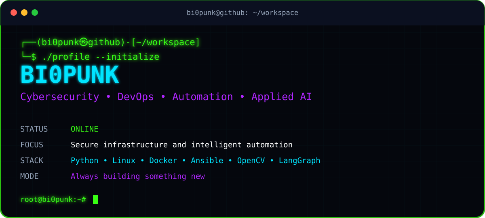

<div align="center">



<br>


</div>

---

## `root@bi0punk:~# whoami`

```yaml
user:       bi0punk
role:       Ingeniero de sistemas · automatización, seguridad y datos
base:       Chile · trabajo remoto
focus:
  - Computer vision sobre RTSP (YOLO / OpenCV)
  - LLM locales y agentes (llama.cpp, LangGraph)
  - Infraestructura reproducible (Docker, Ansible, CI/CD)
  - Pipelines de datos y observabilidad (Kafka, PostgreSQL, Grafana)
principio: "Automatiza lo repetible, observa lo importante, asegura lo demás."
```

Construyo sistemas que **ven, escuchan y deciden** en la periferia: cámaras que
detectan en tiempo real, modelos que corren sin depender de la nube y
automatizaciones que dejan de necesitar a una persona mirando una pantalla.

Me importa que lo que entrego sea **reproducible**: un `docker compose up`, un
CI en verde y una guía que otra persona pueda seguir sin preguntarme nada.

---

## `root@bi0punk:~# ls proyectos/`

| Proyecto | Qué resuelve | Stack |
|---|---|---|
| [**catfinder**](https://github.com/bi0punk/catfinder) | Detección de gatos en cámaras RTSP con overlay, evidencias y alertas por Telegram | Python · YOLO · Flask · Docker |
| [**ipcam-hunter**](https://github.com/bi0punk/ipcam-hunter) | Alerta cuando una persona permanece en una ROI; snapshot a WhatsApp y dashboard MJPEG | Python · YOLO · FastAPI · WAHA |
| [**llama-webapp**](https://github.com/bi0punk/llama-webapp) | Gestor de modelos GGUF y centro de control para `llama-server` desde la web | FastAPI · SQLAlchemy · Redis/RQ |
| [**repo-analyzer**](https://github.com/bi0punk/repo-analyzer) | Diagnóstico de repos y bundle de contexto listo para un LLM; también como GitHub Action | Python · LangChain · Docker |
| [**kpi-datapipeline**](https://github.com/bi0punk/kpi-datapipeline) | Pipeline Kafka → PostgreSQL con KPIs por minuto/hora/día y entrega *at-least-once* | Kafka · PostgreSQL · Docker |
| [**readme-llm-gen**](https://github.com/bi0punk/readme-llm-gen) | Reconstruye READMEs analizando el código, con LLM local | Python · LangGraph · Ollama |

---

## `root@bi0punk:~# cat stack.txt`

<table>
<tr>
<td width="50%" valign="top">

### Core


### Backend


### AI and Data


</td>
<td width="50%" valign="top">

### Infrastructure


### Observability


### Security


</td>
</tr>
</table>

---

## `root@bi0punk:~# cat principios.md`

- **CI verde o no se mergea.** `ruff`, `mypy`, tests con cobertura y auditoría de
  dependencias en cada push.
- **Un comando para probar.** `docker compose up` o `make demo`; si necesita diez
  pasos manuales, todavía no está terminado.
- **La documentación es parte del código.** Configuración, despliegue y
  troubleshooting viven en `docs/`, no en mi cabeza.
- **Seguridad por defecto.** Contenedores sin root, secretos fuera de git y
  dependencias auditadas.
- **Menos ruido, más señal.** Logs útiles, healthchecks y métricas que responden
  “¿está funcionando?” en un vistazo.

---

## `root@bi0punk:~# system-status`

```diff
+ Infrastructure automation       ONLINE
+ Threat detection                ONLINE
+ Security monitoring             ONLINE
+ Local artificial intelligence   ONLINE
+ Data processing pipelines       ONLINE
+ Computer vision systems         ONLINE
+ Continuous learning             ALWAYS ON
```

---

<div align="center">

### `ACCESS GRANTED`


```text
Automate everything.
Secure everything.
Observe everything.
Keep building.
```

**“Hack the planet, automate the boring stuff and engineer systems that last.”**

¿Tienes una cámara, un modelo o un pipeline que necesita dejar de ser manual?
Abre un issue en cualquiera de los repos.

</div>
